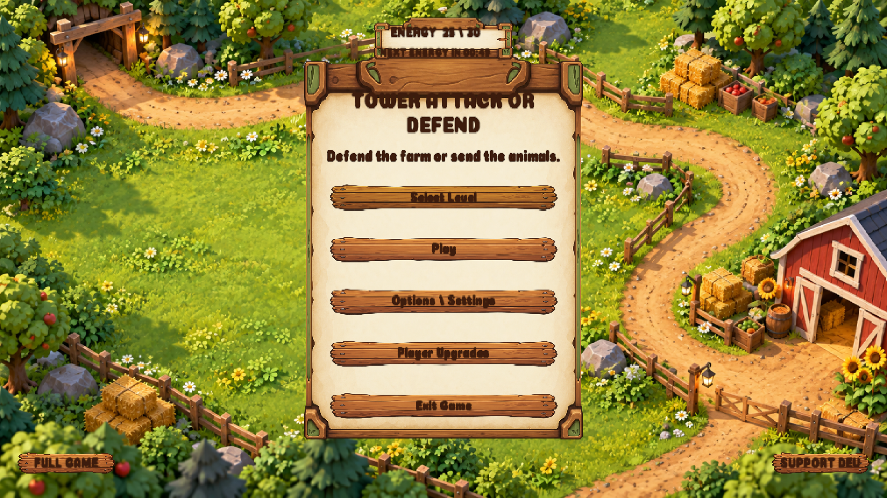
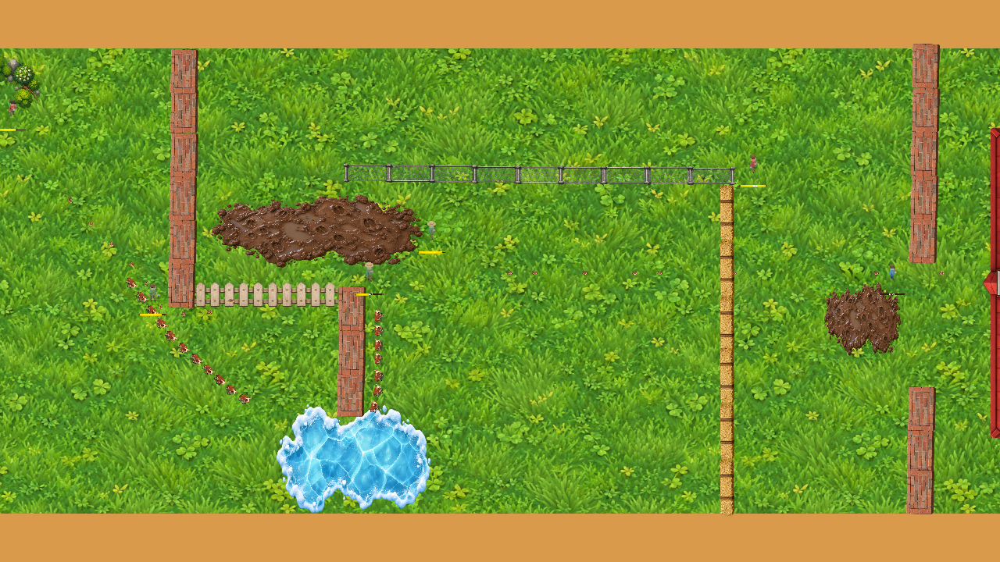
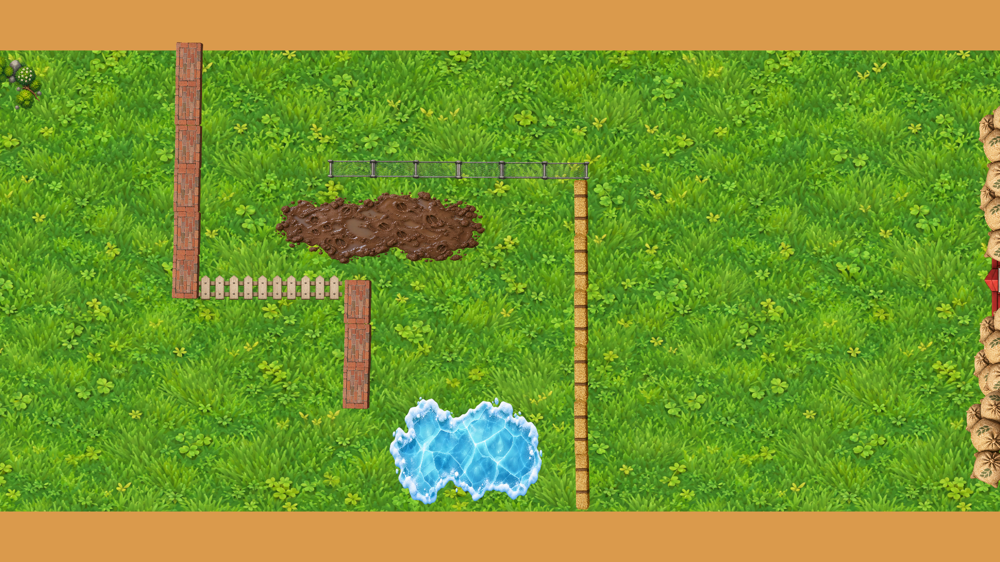
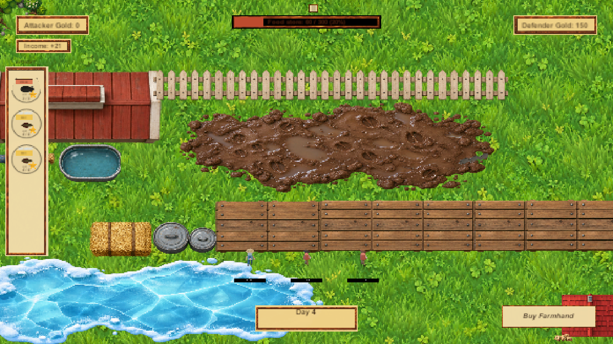
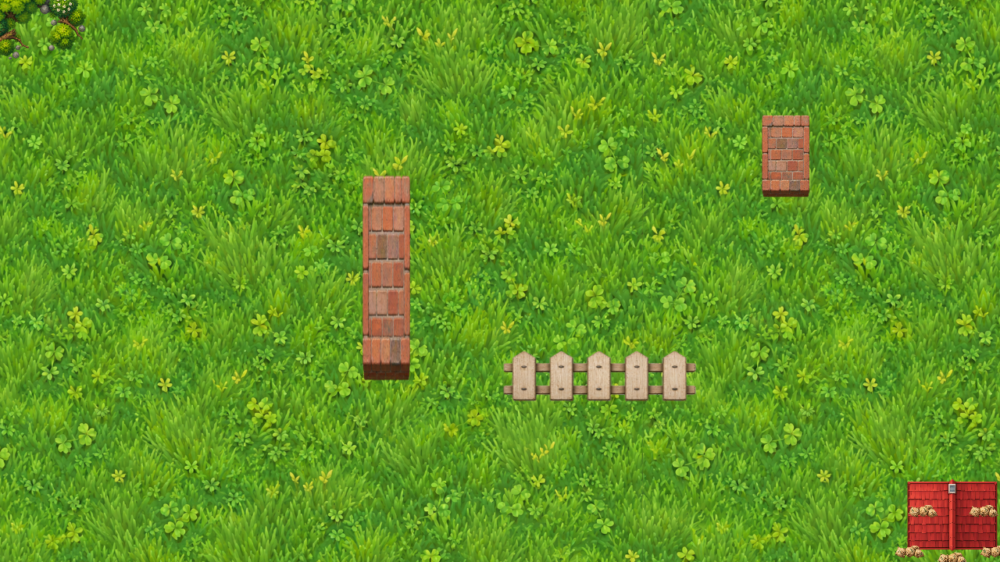

# TAD development catalogue

## 2026-11-02 — responsive game UI and player-upgrade choice pass

The live UI now follows the current hand-drawn layout plan without changing camera or route-mapping bounds. Landscape play places the next-wave queue across the top, attacker controls in a left rail, food and defender information in a right rail, and keeps the level unobstructed in the centre. Portrait uses a top queue and a single-column attacker rail, with dedicated safe space for the food store, banks, day panel, placement controls, and pause/play buttons. The main menu keeps the illustrated farm backdrop and centred wood-and-parchment card, with the player-energy display plus the new Full Game and Support Dev planks; both use the standard planned-feature modal until those flows are implemented.

Player level-up choices now preserve three distinct options: a random attacker upgrade on the left, a fully random centre option, and a random defender upgrade on the right. The revised presentation is covered by responsive layout and progression tests, including tests that prevent HUD and placement-control overlap.

Validation completed before publication:

- Live Unity Play Mode Game-view capture of the Main Menu recorded above; it visibly shows the new menu shell and utility controls.
- Unity compilation: clean, with no Console errors. The only Editor warning recorded before validation was the capture pipeline reporting an already-active Play Mode command, not a game-code warning.
- Required Game Basics gate: EditMode 130/130 and PlayMode 59/59 passed, with zero failures, errors, or inconclusive results.
- Responsive UI regression checks: 10/10 passed, including portrait food/bank and control-spacing coverage.

## 2026-11-02 — responsiveness and motion performance pass

This pass targets the playtest issues where attacker-send taps could be missed and characters could appear to jump rather than move smoothly. Mobile attacker cards now tolerate a small, natural finger drift without being treated as a tray scroll. Send-time work was reduced by batching card and queue refreshes, reusing exact spawn routes, sharing same-frame route-readiness checks, and removing the old per-attacker collision scans. Pools also warm enough attackers for an initial group before a player first sends it.

Attackers no longer use the abrupt vertical walk-frame hop, and relocating farmhands now use Rigidbody interpolation. The defender placement range preview reuses its mesh data and throttles only its non-authoritative visual line-of-sight redraw while a player drags a placement ghost. Combat, collision with the environment, and live targeting rules remain unchanged.

Validation completed before publication:

- Unity compilation: clean, with no current Console errors or warnings.
- Focused route-cache Play Mode validation: 3/3 tests passed, including exact-route reuse and rebuild invalidation.
- Focused attacker animation/collision validation: 3/3 tests passed earlier in the same validation pass.
- Required Game Basics gate: EditMode 126/126 and PlayMode 59/59 passed, with zero failures, errors, or inconclusive results. The targeting fixture now uses the same non-blocking Attacker layer as the shipped attacker prefabs.
- Screenshot captured in the live Level 1 Game view before the Git push. Android device profiling remains the final target-device confirmation; Editor/Windows uses a higher visual quality preset than the mobile targets.

## 2026-10-22 — grass-bounded attacker and defender movement

The authored grass background is now the authoritative playable footprint. Ground attackers and relocating farmhands are clamped and routed within that grass area, so neither can travel into the surrounding presentation background. The food barn may remain visually beyond the grass edge: attackers finish at the last legal grass cell and then resolve their arrival with the Food Store, rather than walking through the barn artwork.

To keep the paths reliable for the whole roster, attacker display size is now separate from route-clearance diameter. Each animal keeps its intended visual scale while using a conservative physical footprint for navigation, including the largest animals. Level 1–4 layouts were not edited during this work.

Validation completed before publication:

- Focused game-basics validation: 40/40 Play Mode tests passed.
- Full Game Basics Edit Mode: 124/124 tests passed.
- Full Game Basics Play Mode: 53/53 tests passed, including the four shipped scenes, grass bounds, barn-edge arrival, pooling, day-cycle, targeting, and farmhand relocation presentation.

## 2026-10-08 — automatic farmhand identities

Farmhands now receive an automatic identity whenever they are taken from the defender pool. Each placement combines one of 27 authored visual profiles (three skin tones, three hair/hat choices, and three outfits) with a randomly selected farmhand name. This is fully automatic—players do not choose cosmetics—and the identity remains intact when a defender relocates.

Validation completed before publication:

- Live Level 2 Play Mode: frames advanced normally; three pooled farmhands appeared with distinct names and visual profiles.
- Unity Game Basics Edit Mode: 83/83 tests passed.
- Unity Game Basics Play Mode: 42/42 tests passed.
- The match-experience presentation test now isolates pending upgrade-card state, so a tester's saved account data cannot affect the result.

## 2026-09-30 — verified codebase cleanup

The production Level 1 scene was captured in Unity Play Mode after the cleanup pass. Deprecated compatibility paths, unused starter packages, unreferenced authoring by-products, and the non-production SampleScene build entry were removed while the active game, menus, levels, art pipeline, and test coverage were retained.

Validation completed before publication:

- Unity compilation: clean, with no Console errors or warnings.
- Edit Mode: 43/43 tests passed.
- Play Mode: 33/33 tests passed, including pooling, large-wave, long-game, routing, combat, UI, progression, and scene-transition coverage.
