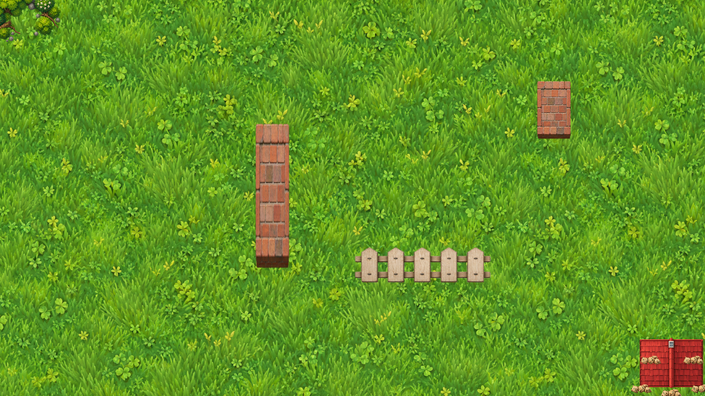

# TAD development catalogue

## 2026-09-30 — verified codebase cleanup

The production Level 1 scene was captured in Unity Play Mode after the cleanup pass. Deprecated compatibility paths, unused starter packages, unreferenced authoring by-products, and the non-production SampleScene build entry were removed while the active game, menus, levels, art pipeline, and test coverage were retained.

Validation completed before publication:

- Unity compilation: clean, with no Console errors or warnings.
- Edit Mode: 43/43 tests passed.
- Play Mode: 33/33 tests passed, including pooling, large-wave, long-game, routing, combat, UI, progression, and scene-transition coverage.
