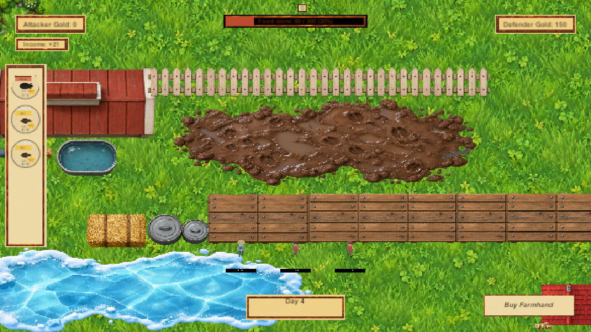

# TAD development catalogue

## 2026-10-08 — automatic farmhand identities

Farmhands now receive an automatic identity whenever they are taken from the defender pool. Each placement combines one of 27 authored visual profiles (three skin tones, three hair/hat choices, and three outfits) with a randomly selected farmhand name. This is fully automatic—players do not choose cosmetics—and the identity remains intact when a defender relocates.

Validation completed before publication:

- Live Level 2 Play Mode: frames advanced normally; three pooled farmhands appeared with distinct names and visual profiles.
- Unity Game Basics Edit Mode: 83/83 tests passed.
- Unity Game Basics Play Mode: 42/42 tests passed.
- The match-experience presentation test now isolates pending upgrade-card state, so a tester's saved account data cannot affect the result.

## 2026-09-30 — verified codebase cleanup

The production Level 1 scene was captured in Unity Play Mode after the cleanup pass. Deprecated compatibility paths, unused starter packages, unreferenced authoring by-products, and the non-production SampleScene build entry were removed while the active game, menus, levels, art pipeline, and test coverage were retained.

Validation completed before publication:

- Unity compilation: clean, with no Console errors or warnings.
- Edit Mode: 43/43 tests passed.
- Play Mode: 33/33 tests passed, including pooling, large-wave, long-game, routing, combat, UI, progression, and scene-transition coverage.
